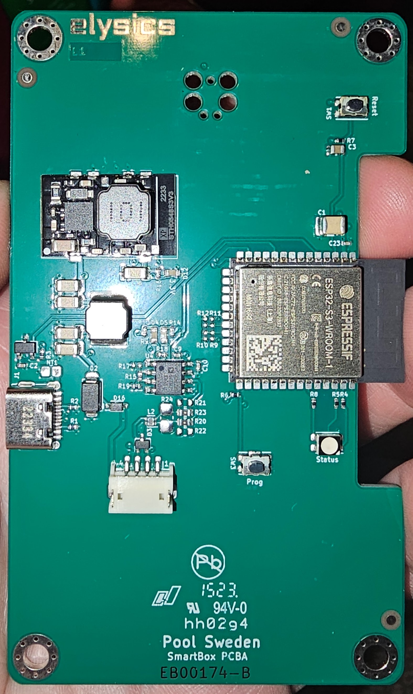
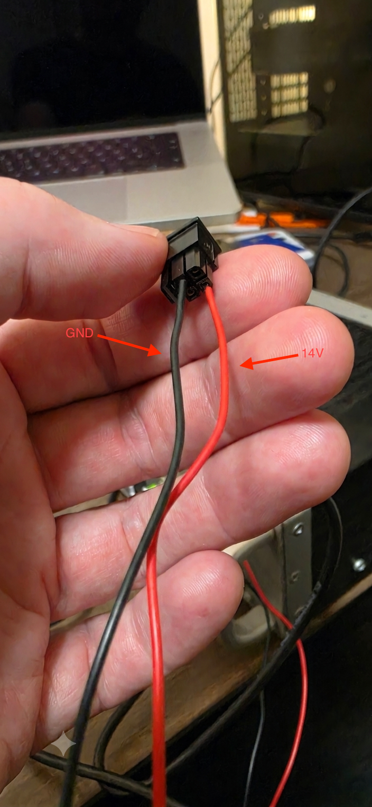
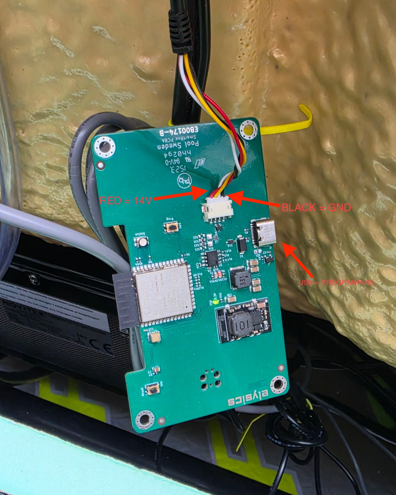

# Zavepower Energy Optimizer → Home Assistant (ESPHome)

> ⚠️ **Unofficial, community open-source project.** This is **not** affiliated
> with, endorsed by, or supported by Zavepower, elysics, Pool Sweden, Balboa, or
> any spa manufacturer. All product names and trademarks belong to their
> respective owners. This is independent open-source work provided **as-is under
> the [MIT License](LICENSE), with no warranty** — use it entirely at your own
> risk (see the flashing warning below).

A ready-to-use [ESPHome](https://esphome.io) config that reflashes the deprecated
**Zavepower Energy Optimizer** / elysics "Pool Sweden SmartBox" board (marking
`EB00174-B`, built around an ESP32-S3-WROOM-1) and turns it into a WiFi bridge
between your **Balboa spa** and **Home Assistant**. It also exposes the board's
onboard RGB LED as a controllable light.

Everything you need is in **`zavepower_energy_optimizer.yaml`** — confirmed GPIO
pinout, spa UART settings, and a representative set of spa entities.

Spa communication uses a maintained copy of
[brianfeucht/esphome-balboa-spa v2.30](https://github.com/brianfeucht/esphome-balboa-spa/releases/tag/v2.30),
with confirmed-command delivery for pumps, main light, heat mode, and temperature
range. The source and upstream license are in `components/balboa_spa`; see
[component provenance](components/balboa_spa/UPSTREAM.md) for the local changes.
The device config downloads this component from this repository's `v1` tag.

> ⚠️ **This permanently erases the original Zavepower firmware.** Flashing
> ESPHome overwrites the stock firmware, and there is **no way to restore it** —
> no backup or factory image is available, so the board will no longer work with
> the original Zavepower/Pool Sweden cloud service or app. **Proceed entirely at
> your own risk.**

> **Tested hardware:** This has been tested on a **Novitek Luosto S** spa. That
> is the only spa I have access to, so I have no way to test any other spa models
> — other Balboa-based spas will likely work, but I can't verify them. Reports
> (and PRs) from other spas are welcome.

## The board



Key features to locate on your board:

- **ESP32-S3-WROOM-1** — the WiFi module (top right).
- **USB-C connector** — used for the first flash and serial logs (left edge).
- **4-pin JST connector** — the spa harness; carries **14 V power + RS-485 data**
  to/from the spa controller (bottom center).
- **Prog** button — hold to enter the ESP32 bootloader.
- **Reset** button — reboots the board.
- **RGB LED** (labelled *Status*) — a full-color LED exposed to Home Assistant.
  You can drive it yourself to signal whatever you like — e.g. define your own
  color codes for heating, filtering, or fault states (see the commented example
  at the bottom of `zavepower_energy_optimizer.yaml`). Note that once the board
  is installed the LED is normally hidden inside the enclosure, so it's mostly
  useful during bench testing.

## Powering the board

The ESP32 side needs **14 V** on the power input; the onboard buck converter
steps it down to 3.3 V. **USB-C is used for programming/logs only** and does not
power the board. So during setup you power the board one of two ways *and* plug
in USB-C for flashing.

**Option A — external bench supply (recommended for setup on the bench)**

Feed 14 V into the 2-pin power connector: **red = 14 V, black = GND**.



**Option B — power from the spa harness (in place, on the spa)**

The spa's own 4-pin cable already provides 14 V and GND, so once the board is
wired to the spa it is powered by the spa. Plug in USB-C for flashing.



> ⚠️ **Never connect both** the external supply **and** the spa harness 14 V at
> the same time — pick one power source. USB-C can stay connected in either case.

## Confirmed GPIO pinout (EB00174 board)

The pins below were confirmed on-hardware. The `substitutions` in
`zavepower_energy_optimizer.yaml` already use these values, so you shouldn't need to
change them on the same board revision.

| Signal | GPIO | Notes |
|---|---|---|
| Spa UART RX | `GPIO18` | ADM3483 RO (pin 1); also the **red RX-activity LED** |
| Spa UART TX | `GPIO17` | ADM3483 DI (pin 4); also the **green TX-activity LED** |
| Spa UART direction | `GPIO6` | ADM3483 `/RE`+`DE`; `flow_control_pin` (drive HIGH to transmit) |
| RGB LED — red | `GPIO1` | common-anode (active-low → `inverted: true`) |
| RGB LED — green | `GPIO2` | common-anode |
| RGB LED — blue | `GPIO42` | common-anode |

The spa bus is a non-isolated half-duplex RS-485 link via an **Analog Devices
ADM3483** transceiver. The two single LEDs are wired directly on the UART RX/TX
lines, so they act as receive/transmit activity indicators (not separately
controllable). The RGB LED is exposed to Home Assistant as a controllable light.

Known by convention: Prog button = `GPIO0`, Reset = `EN`, USB-C = native USB.

If you have a different board revision, re-confirm the pins before flashing:
trace the ADM3483 transceiver for the UART pins (RO → RX, DI → TX, `/RE`+`DE` →
direction), and blink candidate GPIOs to locate the LEDs (noting active-high/low
polarity).

## Two ways to use this config

- **Import as a versioned project (gets update notifications).** Your device
  config is a small wrapper that pulls this repo in as a package, pinned to the
  floating `v1` tag. When a new `1.x` release is tagged here, the ESPHome
  dashboard shows **Update Available** on your device — one click to rebuild and
  OTA. See [Import as a versioned project](#import-as-a-versioned-project).
- **Paste the full config (simple, no auto-updates).** Copy
  `zavepower_energy_optimizer.yaml` into your device and edit it directly. This is
  the [step-by-step setup](#step-by-step-setup-esphome-dashboard-in-home-assistant--recommended)
  below.

Both use the same config; the import method just tracks releases automatically.

### Import as a versioned project

Create a new device in the ESPHome dashboard and replace its config with this
thin wrapper (set the name to whatever you like):

```yaml
substitutions:
  name: zavepower-spa
packages:
  osro.zavepower-spa: github://osro/esphome-zavepower/zavepower_energy_optimizer.yaml@v1
esphome:
  name: "${name}"
```

Then add your secrets (`wifi_ssid`, `wifi_password`, `spa_api_key` — see
[step 4](#step-by-step-setup-esphome-dashboard-in-home-assistant--recommended)
below) and install. On a different board revision, override the pin
`substitutions` in the wrapper too. From then on, new releases surface as an
update badge in the dashboard. To pin to an exact release instead of tracking
`1.x`, use a full tag like `@v1.0.0`.

## Step-by-step setup (ESPHome Dashboard in Home Assistant — recommended)

This is the easiest path if you run Home Assistant OS/Supervised: you do
everything from the **ESPHome Device Builder** add-on's web UI in your browser,
and only need USB for the very first flash.

**1. Wire up the board.** Connect the Energy Optimizer to the spa's 4-pin harness (this
supplies 14 V + RS-485) *or*, for bench setup, feed 14 V into the 2-pin power
connector (red = 14 V, black = GND). See [Powering the board](#powering-the-board)
above. Use only one 14 V source.

**2. Install the ESPHome add-on.** In Home Assistant, go to **Settings → Add-ons
→ Add-on Store**, install **ESPHome Device Builder**, then **Start** it and click
**Open Web UI**. (This also installs the ESPHome integration.)

**3. Create the device config.** In the ESPHome dashboard click **+ New Device →
Continue**, give it a name (e.g. `zavepower-spa`), pick **ESP32-S3** if asked,
and **Skip** the wizard's WiFi step for now (you'll paste the full config next).
This generates an entry and its API/OTA keys in `secrets.yaml`.

**4. Paste in this config.** Click **Edit** on the new device and replace its
contents with `zavepower_energy_optimizer.yaml` from this repo. Then set your WiFi in the
ESPHome dashboard's **Secrets** editor (top-right menu → **Secrets**):

```yaml
wifi_ssid: "YourNetwork"
wifi_password: "YourPassword"
spa_api_key: "your-32-byte-base64-key"
```

The `spa_api_key` encrypts the Home Assistant ↔ device API connection (otherwise
the device shows as **Not encrypted** in the ESPHome dashboard). Add all three as
**Shared** secrets — `!secret` in the config resolves against the shared
`secrets.yaml`.

A **device-specific secret name** like `spa_api_key` is recommended over a generic
`api_encryption_key` so each ESPHome device has its own key instead of sharing
one. Generate a 32-byte base64 value with `openssl rand -base64 32`, or copy the
key the ESPHome dashboard offers when adding a device. If the wizard already
generated an encryption key for this device back in step 3, you can reuse that
value — just make sure the secret name matches the `!secret` in the config
(rename it to `spa_api_key`, or change the config to reference the wizard's name).

Home Assistant will ask for this key when it adds the device (step 7); if the
device was already added unencrypted, HA prompts you to re-authenticate after the
next flash — paste the same key. Keep it secret and don't commit `secrets.yaml`.

Check the temperature scale: `spa_temp_scale` is `C` by default — change it to
`F` if your spa topside panel is in Fahrenheit. (On a different board revision,
also update the pin `substitutions` to the values you confirmed above.)

**5. First flash over USB.** Plug the board into the machine running the ESPHome
dashboard via USB-C (make sure it's also powered per step 1). Click **Install →
Plug into this computer** (or **Plug into the computer running ESPHome Web** and
use [web.esphome.io](https://web.esphome.io) from Chrome/Edge if the add-on can't
see the port). If the upload fails, hold **Prog**, tap **Reset**, release
**Prog** to force the bootloader, and retry.

**6. Verify communication.** Click **Logs** on the device. You should see spa
messages being decoded and the **Spa Connected** sensor go on; the red/green
activity LEDs on the board blink with RS-485 RX/TX traffic. Frequent `CRC`
warnings are normal — see [Troubleshooting](#crc-errors).

**7. Add to Home Assistant.** Once on WiFi, HA auto-discovers the device under
**Settings → Devices & Services** (look for `zavepower-spa`). Click **Configure**
and confirm. All spa entities (thermostat, jets, lights, filter schedule, fault
log, RGB status LED, …) appear as one device.

**8. Done — future updates are wireless.** After the first USB flash, use
**Install → Wirelessly** in the ESPHome dashboard for all later changes; USB is
only needed again if the board can't reach the network.

### Alternative: flashing from the command line

If you don't run the Home Assistant add-on, you can use the ESPHome CLI instead:

```bash
pip install esphome
# create secrets.yaml next to the config with wifi_ssid / wifi_password
esphome run zavepower_energy_optimizer.yaml   # first flash over USB, OTA thereafter
esphome logs zavepower_energy_optimizer.yaml  # view logs
```

Then add it to Home Assistant as in step 7 above.

## Customizing the entities

The shipped config exposes a representative set of spa entities (thermostat,
jets, lights, filter scheduling, fault log, and more). To add or tweak entities,
edit `zavepower_energy_optimizer.yaml` — the full list of platforms and options
provided by the `balboa_spa` component is documented in the
[upstream esphome-balboa-spa repo](https://github.com/brianfeucht/esphome-balboa-spa).

### Confirmed commands

A click on Jet 1, Lights, Heat Mode (Ready), or Temperature Range (High) records
a desired state. The device sends one toggle at a time when the spa grants a
transmission slot, then waits for a valid status packet received at least
1.5 seconds after transmission. It retries only when that fresh report still
shows the wrong state. Unchanged status packets count as fresh feedback; cached
ESPHome updates do not. Jets 2–4 use the same mechanism when configured.

The limit is five transmissions per request and 30 seconds from the click,
including time waiting for the bus. A newer opposite request replaces the old
target, while still waiting for any already-transmitted toggle to settle.
Identical repeated requests do not reset the limit. Requests are not saved
across reboot and expire during loss of communication.

Switches retain the requested display while waiting. **Spa Command Pending**
is on until the request is confirmed or expires. **Spa Command Failed** turns
on when the attempt/deadline limit is reached; the control then returns to the
last reported spa state. This failure indicator clears on the next request.
Logs identify requested, transmitted, confirmed, and failed commands.
Control numbers in logs are 0–3 for jets 1–4, 4 for Lights, 5 for Temperature
Range, and 6 for Ready mode.

The spa can refuse a request, for example when a pump must run for filtration.
Confirmation improves delivery but cannot override the controller. There is no
transaction acknowledgement in this toggle protocol: a response delayed beyond
the settling interval or a simultaneous topside-panel action can still create
ambiguity. Hardware testing remains necessary.

Filter 2 enable/schedules, temperature setpoint, blower, and second light retain
upstream behaviour and do not use these confirmation retries. The thermostat's
heat-mode and range requests do use the shared controller.

### Developing and testing locally

The remote `v1` component source becomes available only after these component
files have been published in a release. To test an unpublished checkout, use
ESPHome locally and replace the device config's `external_components` block with:

```yaml
external_components:
  - source:
      type: local
      path: components
    components: [balboa_spa]
```

Keep the `components` directory alongside the YAML, and provide your usual
`secrets.yaml`. For validation without real credentials or device access:

```sh
python3 -m venv .venv
.venv/bin/pip install esphome==2026.9.0
sh tests/run_native.sh
.venv/bin/python tests/check_firmware.py
.venv/bin/python tests/check_firmware.py --compile
```

The validation script uses fake credentials and the local component; its build
is **not for installation**. For a device trial, compile your real configuration,
then check each affected control with one click, watch Pending clear, and compare
the actual spa/topside state. Test an opposite click while Pending is on and
confirm a refused request times out rather than toggling indefinitely.

Upstream updates now require reviewing and updating the maintained component
copy; changing only a version reference does not update its code.

## Releasing (maintainers)

Versioning is automated with [release-please](https://github.com/googleapis/release-please).
Commits on `main` use [Conventional Commits](https://www.conventionalcommits.org)
(`feat:`, `fix:`, `docs:`, …); release-please keeps a "release" PR open that
bumps `esphome.project.version` in `zavepower_energy_optimizer.yaml` (the
`# x-release-please-version` line) and updates the changelog. Merging that PR
tags a new `vX.Y.Z` release, and the workflow moves the floating major tag
(`vX`) that `dashboard_import` / package imports point at — which is what makes
followers' dashboards show **Update Available**.

`fix:`/`feat:` bump the patch/minor version; a `!` or `BREAKING CHANGE` bumps the
major, in which case update `dashboard_import` and the README wrapper to the new
`vN` tag.

## Troubleshooting

### CRC Errors

CRC errors are very common with Balboa spa controllers due to electrical
interference from heaters and pumps. Seeing frequent `CRC` messages in the logs
is normal and usually harmless. To silence them specifically while keeping other
DEBUG-level logging:

```yaml
logger:
  level: DEBUG
  logs:
    BalboaSpa.CRC: NONE  # Silence CRC error messages
```

## Screenshots

### ESP WebUI


### Home Assistant UI

